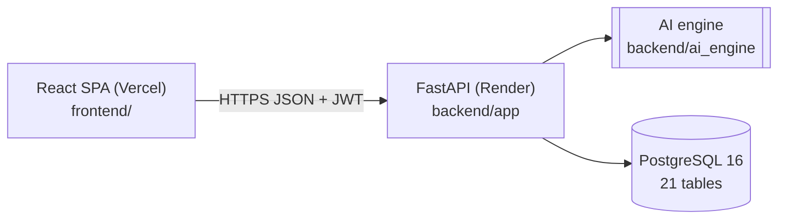

# LUMORA: AI-Powered Upskilling Recommendation and Automation System for Students

[](https://github.com/Nami-181/ai-upskilling-recommendation-system/actions/workflows/ci.yml)

LUMORA reads a student's profile (skills, courses, projects and goal role) and finds the skill gap for that role. From the gap it builds a **personalised, week-by-week learning path** with curated resources, hands-on projects and certifications, and explains every recommendation. It tracks progress and **adapts the path automatically** from quiz scores, feedback and inactivity.

Software Engineering mini-project, problem #22 · **Team 22, ProjectSync**

| Member | Role | GitHub |
| --- | --- | --- |
| Nidhi (M1) | Frontend: React UI, design system | _to be added_ |
| Nami (M2) | Backend + database: FastAPI, PostgreSQL, APIs | [@Nami-181](https://github.com/Nami-181) |
| Riya (M3) | AI/ML engine: taxonomy, gap scoring, ranking, adaptivity | [@riyaharugop](https://github.com/riyaharugop) |
| Rhea (M4) | Integration, testing, deployment | [@Rheanair30](https://github.com/Rheanair30) |

## Architecture



| Folder | What | Owner |
| --- | --- | --- |
| [`frontend/`](frontend) | React 19 + Vite + Tailwind: 5 public, 6 auth and 15 app pages | M1 |
| [`backend/app/`](backend/app) | FastAPI REST API (48 endpoints), SQLAlchemy models, Alembic migrations, seed | M2 |
| [`backend/ai_engine/`](backend/ai_engine) | Datasets, skill taxonomy, gap scoring, resource ranking, path planner, adaptive rules, evaluation | M3 |
| [`backend/tests/`](backend/tests), [`postman/`](postman), [`.github/`](.github) | pytest suites, Postman collection, CI/CD and PR automation | M4 |
| [`docs/`](docs) | SRS, architecture, database, API, AI engine, test plan and report, deployment, deviations, backlog | all |
| [`prototype/streamlit-mvp/`](prototype/streamlit-mvp) | Sprint 1 Streamlit prototype (kept for reference) | M2 |

## Run it

**With Docker** (PostgreSQL, API and frontend):

```bash
docker compose up --build
```

Open http://localhost:5173 (app) and http://localhost:8000/docs (API docs).

**Without Docker:**

```bash
cd backend && pip install -r requirements-dev.txt && uvicorn app.main:app --reload    # API on :8000 (SQLite)
cd frontend && cp .env.example .env && npm install && npm run dev                     # UI on :5173
```

**Demo accounts** (seeded automatically):

| Role | Email | Password |
| --- | --- | --- |
| Student (with a profile) | demo@lumora.app | Lumora@2026 |
| Admin | admin@lumora.app | Admin@2026 |

A new sign-up needs email verification. Without SMTP configured, the API runs in demo mode and the verify page shows the code.

## Test it

```bash
cd backend
pytest --cov=app --cov=ai_engine        # 52 tests, 93% coverage
python -m ai_engine.evaluate            # recommendation accuracy on 8 sample profiles
npx newman run ../postman/LUMORA.postman_collection.json   # with the API running
```

CI (GitHub Actions) runs lint, the tests on PostgreSQL, a migration check, Newman, the accuracy check, the frontend build and the prototype tests on every pull request.

## How the AI works (short version)

- **Gap:** for each skill the role needs, gap = weight × (required − current). Readiness = weighted share of requirements met.
- **Priority:** importance = 0.5 · weight + 0.35 · shortfall + 0.15 · how many other gaps the skill unlocks.
- **Path:** prerequisites first (topological sort), packed into your weekly hours to give due dates.
- **Resources:** ranked by level match, rating, free, preferred type and length. The top 3 per skill each come with a reason.
- **Adapts:** a quiz ≥ 80% completes the module. A quiz < 50% adds easier material and time. "Too hard" or "too easy" feedback swaps the resource. Seven days of inactivity sends a nudge.

Details and evaluation: [docs/ai-engine.md](docs/ai-engine.md).

## Documentation

- [Software architecture](docs/architecture.md) · [Database (ER diagram + data dictionary)](docs/database.md) · [API reference](docs/api.md)
- [AI engine](docs/ai-engine.md) · [Test plan](docs/test-plan.md) · [Test report](docs/test-report.md)
- [Deployment (Render + Vercel)](docs/deployment.md) · [Deviations](docs/deviations.md) · [Backlog](docs/backlog.md) · [SRS](docs/SRS.md)
- College deliverables: [`docs/deliverables/`](docs/deliverables) (22_Project Test Plan, 22_Jira Backlog, 22_SW Architecture)

## Workflow

Backlog items are GitHub issues, with story points, an assignee and a sprint milestone. Each member works on a feature branch and opens a PR that links its issue ("Closes #n"). CI and CODEOWNERS reviews run automatically, and the repo owner merges. See [CREDITS.md](CREDITS.md) for the projects and data we reused.
