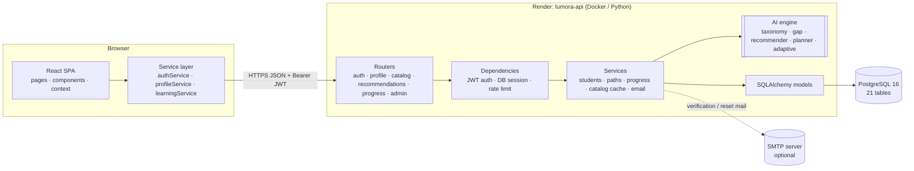
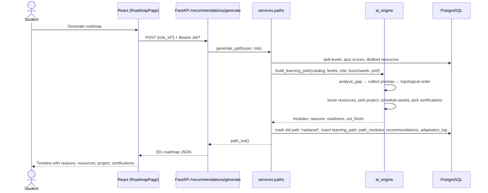
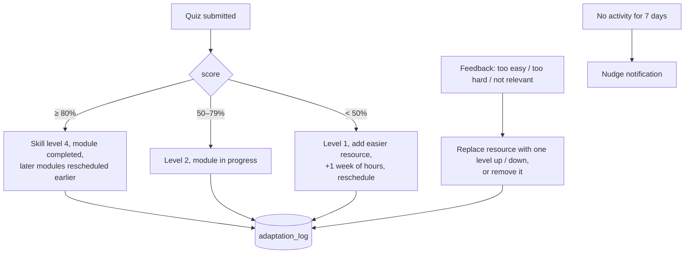
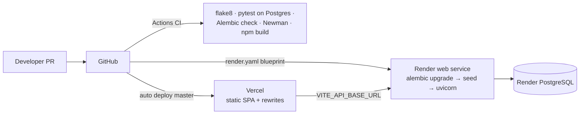

# Software architecture: LUMORA

**Project:** AI-Powered Upskilling Recommendation and Automation System for Students (problem #22)
**Team 22, ProjectSync:** M1 Nidhi (frontend) · M2 Nami (backend and database) · M3 Riya (AI/ML engine) · M4 Rhea (integration, testing and deployment)

## 1. Architectural style

LUMORA is a **three-tier client–server web application** with a layered backend:

| Tier | Technology | Responsibility |
| --- | --- | --- |
| Presentation | React 19 SPA (Vite, Tailwind v4, react-router 7, recharts) on Vercel | Screens, client validation, charts, session token storage |
| Application | FastAPI (Python 3.12) on Render | REST API, auth, validation, business rules, orchestration of the AI engine |
| AI engine | `backend/ai_engine` (pandas, NumPy), in-process library | Taxonomy, skill extraction, gap scoring, ranking, path planning, adaptivity |
| Data | PostgreSQL 16 (Render) through SQLAlchemy 2.0 + Alembic | Persistent store for users, profiles, catalogue, stored paths/recommendations, progress |

The AI engine is a **pure library** with no database or web code. The API loads the catalogue from the database into a `Catalog` object, which is cached and refreshed when an admin edits it. It then calls the engine's functions and stores the results. This keeps the engine unit-testable on its own (Member 3), and it could be moved into a separate microservice later without changing its code.

## 2. Component diagram

## 3. Backend layers (`backend/app`)

| Layer | Files | Rule |
| --- | --- | --- |
| Routers | `api/routes/*.py` | HTTP only: parse input with pydantic schemas, call a service, return JSON. No SQL beyond simple lookups. |
| Dependencies | `api/deps.py`, `core/ratelimit.py` | `CurrentUser`, `AdminUser`, `OptionalUser`, `SessionDep`, auth rate limiting |
| Schemas | `schemas.py` | Request validation (password policy, URL, ranges), camelCase aliases for the frontend user/profile contract |
| Services | `services/*.py` | Business logic and transactions: generate and store paths, apply quiz/feedback adaptation, analytics |
| Models | `models.py` | 21 SQLAlchemy tables (see [database.md](database.md)) |
| Core | `core/config.py`, `db.py`, `security.py`, `errors.py` | Settings from env, engine/session, bcrypt and JWT, uniform error shape |

**Reused design:** the project layout, settings, dependency-injection style and JWT/bcrypt security module follow [fastapi/full-stack-fastapi-template](https://github.com/fastapi/full-stack-fastapi-template) (MIT). That repository was the closest maintained match, and we adapted its patterns rather than writing them from scratch. See [CREDITS.md](../CREDITS.md).

## 4. Key flows

### 4.1 Generate a learning path (FR-013 to FR-036)

### 4.2 Adaptive loop (FR-043 to FR-047)

## 5. Deployment view

The whole stack also runs locally with `docker compose up` (PostgreSQL, API and an nginx-served frontend). See [deployment.md](deployment.md).

## 6. Cross-cutting concerns

| Concern | Design decision | Requirement |
| --- | --- | --- |
| Authentication | Email/password, bcrypt hashes, HS256 JWT (7 days), verified email required before login | FR-001, FR-004, FR-005, NFR-009 |
| Authorisation | `role` column (student/admin); `AdminUser` dependency; every student query is filtered by `user_id`, and items of other users return 404 | FR-003, NFR-013 |
| One-time tokens | 32-byte random, only SHA-256 stored, single use, expiry (48 h verify, 1 h reset) | NFR-010 |
| Rate limiting | Sliding window per IP and path on public auth endpoints (default 20/min) → 429 | NFR-011 |
| Input validation | pydantic v2 schemas; uniform error `{"detail": {"code", "message"}}` | NFR-010 |
| SQL injection | ORM with bound parameters only (tested) | NFR-010 |
| CORS | Allow-list from `CORS_ORIGINS` plus `*.vercel.app` previews | NFR-008 |
| Privacy | `GET /profile/export` (JSON) and `DELETE /profile` (cascade) | NFR-015 |
| Explainability | Every module and recommendation stores a human-readable `reason` | FR-023 |
| AI audit log | `adaptation_log` records every generate/complete/remediate/replace decision | NFR-028, NFR-017 |
| Caching | Catalogue DataFrames cached in process and invalidated on admin edits | NFR-007 |
| Graceful degradation | If the target role has no requirement data, the API returns a clear 4xx error instead of a crash; the frontend shows error/empty states with retry | NFR-020 |
| Responsiveness and accessibility | Tailwind responsive layout, labelled inputs, focus rings, keyboard-reachable dialogs | NFR-021, NFR-023, NFR-024 |
| Containerisation, CI/CD | Dockerfiles, docker-compose, GitHub Actions, Render blueprint | NFR-026, NFR-027 |

## 7. Technology choices

| Choice | Alternatives considered | Reason |
| --- | --- | --- |
| FastAPI | Django REST, Flask | Async-ready, automatic OpenAPI docs at `/docs`, pydantic validation, team knows Python |
| PostgreSQL | MySQL, MongoDB | Relational data (users ↔ paths ↔ modules ↔ recommendations), JSON columns where needed, free tier on Render |
| SQLAlchemy 2.0 + Alembic | raw SQL | Typed models, migrations that also run on SQLite for tests |
| Content-based ranking in pandas | collaborative filtering, LLM | No interaction data exists yet (cold start); weighted rules are explainable and testable |
| React + Vite | Next.js | Member 1's existing Lumora frontend; static hosting on Vercel |
