# Database design

_Generated from `backend/app/models.py` by `backend/scripts/gen_db_docs.py`. Do not edit by hand._

PostgreSQL 16 in production (Render), SQLite for local runs and tests. Schema migrations are managed with Alembic (`backend/alembic/versions`). **21 tables**: catalogue (reference data seeded from `ai_engine/data/*.csv`), student data, and stored AI output.

## ER diagram

```mermaid
erDiagram
    career_roles ||--o{ certifications : "role_id"
    career_roles ||--o{ learning_paths : "role_id"
    career_roles ||--o{ role_skills : "role_id"
    career_roles ||--o{ student_profiles : "target_role_id"
    learning_paths ||--o{ path_modules : "path_id"
    learning_paths ||--o{ recommendations : "path_id"
    path_modules ||--o{ recommendations : "module_id"
    skills ||--o{ path_modules : "skill_id"
    skills ||--o{ project_ideas : "skill_id"
    skills ||--o{ quiz_attempts : "skill_id"
    skills ||--o{ quiz_questions : "skill_id"
    skills ||--o{ resources : "skill_id"
    skills ||--o{ role_skills : "skill_id"
    skills ||--o{ skill_prereqs : "prereq_skill_id"
    skills ||--o{ skill_prereqs : "skill_id"
    skills ||--o{ student_skills : "skill_id"
    users ||--o{ adaptation_log : "user_id"
    users ||--o{ auth_tokens : "user_id"
    users ||--o{ feedback : "user_id"
    users ||--o{ learning_paths : "user_id"
    users ||--o{ progress_events : "user_id"
    users ||--o{ quiz_attempts : "user_id"
    users ||--o{ recommendations : "user_id"
    users ||--o{ student_courses : "user_id"
    users ||--o{ student_projects : "user_id"
    users ||--o{ student_skills : "user_id"
    users ||--o| student_profiles : "user_id"
    career_roles {
        varchar id PK
        varchar title
        text description
    }
    skills {
        varchar id PK
        varchar name
        varchar category
        text synonyms
    }
    users {
        integer id PK
        varchar email
        varchar hashed_password
        varchar first_name
        varchar last_name
        varchar role
        boolean is_verified
        boolean is_active
        datetime created_at
        datetime last_active_at
    }
    adaptation_log {
        integer id PK
        integer user_id FK
        varchar action
        varchar title
        text detail
        boolean is_read
        datetime created_at
    }
    auth_tokens {
        integer id PK
        integer user_id FK
        varchar purpose
        varchar token_hash
        datetime expires_at
        datetime used_at
        datetime created_at
    }
    certifications {
        varchar id PK
        varchar role_id FK
        varchar title
        varchar provider
        varchar cost
        varchar url
        boolean is_free
        integer level
    }
    feedback {
        integer id PK
        integer user_id FK
        varchar type
        varchar item_type
        varchar item_id
        varchar value
        integer rating
        text comment
        varchar name
        varchar email
        varchar subject
        datetime created_at
    }
    learning_paths {
        integer id PK
        integer user_id FK
        varchar role_id FK
        varchar status
        float readiness
        integer total_hours
        integer hours_per_week
        date est_finish
        datetime created_at
    }
    progress_events {
        integer id PK
        integer user_id FK
        varchar item_type
        varchar item_id
        varchar status
        integer minutes
        datetime created_at
    }
    project_ideas {
        varchar id PK
        varchar skill_id FK
        varchar title
        integer level
        integer est_hours
        text description
    }
    quiz_attempts {
        integer id PK
        integer user_id FK
        varchar skill_id FK
        float score
        json answers
        varchar action
        datetime created_at
    }
    quiz_questions {
        varchar id PK
        varchar skill_id FK
        text question
        json options
        integer answer_index
    }
    resources {
        varchar id PK
        varchar skill_id FK
        varchar title
        varchar provider
        varchar url
        varchar type
        integer level
        float duration_hrs
        boolean is_free
        float rating
    }
    role_skills {
        varchar role_id PK
        varchar skill_id PK
        integer weight
        integer required_level
    }
    skill_prereqs {
        varchar skill_id PK
        varchar prereq_skill_id PK
    }
    student_courses {
        integer id PK
        integer user_id FK
        varchar title
        varchar provider
        varchar status
        date completed_on
    }
    student_profiles {
        integer user_id PK
        varchar program
        varchar institution
        integer year
        text bio
        varchar target_role_id FK
        integer hours_per_week
        varchar preferred_type
        json interests
        boolean onboarding_complete
        datetime updated_at
    }
    student_projects {
        integer id PK
        integer user_id FK
        varchar title
        text description
        varchar tech_stack
        varchar url
    }
    student_skills {
        integer user_id PK
        varchar skill_id PK
        integer level
        varchar source
        datetime updated_at
    }
    path_modules {
        integer id PK
        integer path_id FK
        varchar skill_id FK
        integer order_no
        integer week_no
        integer hours
        date due_date
        varchar status
        text reason
        float importance
        integer current_level
        integer target_level
        datetime completed_at
    }
    recommendations {
        integer id PK
        integer user_id FK
        integer path_id FK
        integer module_id FK
        varchar item_type
        varchar item_id
        float score
        text reason
        varchar status
        boolean saved
        datetime created_at
    }
```

## Data dictionary

### `career_roles`

Target career roles (9) with description and demand notes.

| Column | Type | Null | Key / constraint | Default |
| --- | --- | --- | --- | --- |
| id | varchar(80) | no | PK |  |
| title | varchar(120) | no | unique |  |
| description | text | no |  | empty string |

Constraint `UniqueConstraint`: unique (title)

### `skills`

Skill taxonomy: 33 skills with category and synonyms used for extraction.

| Column | Type | Null | Key / constraint | Default |
| --- | --- | --- | --- | --- |
| id | varchar(50) | no | PK |  |
| name | varchar(100) | no |  |  |
| category | varchar(50) | no |  |  |
| synonyms | text | no |  | empty string |

### `users`

Accounts for students and admins (bcrypt password hash, verification flag, last activity).

| Column | Type | Null | Key / constraint | Default |
| --- | --- | --- | --- | --- |
| id | integer | no | PK |  |
| email | varchar(255) | no | unique, indexed |  |
| hashed_password | varchar(255) | no |  |  |
| first_name | varchar(100) | no |  |  |
| last_name | varchar(100) | no |  | empty string |
| role | varchar(20) | no |  | 'student' |
| is_verified | boolean | no |  | False |
| is_active | boolean | no |  | True |
| created_at | datetime | no |  | now (UTC) |
| last_active_at | datetime | no |  | now (UTC) |

Constraint `ck_users_role`: role IN ('student', 'admin')

### `adaptation_log`

Audit log of every AI decision (generated, completed, remediated, replaced, removed).

| Column | Type | Null | Key / constraint | Default |
| --- | --- | --- | --- | --- |
| id | integer | no | PK |  |
| user_id | integer | no | FK → users.id on delete cascade, indexed |  |
| action | varchar(30) | no |  |  |
| title | varchar(200) | no |  |  |
| detail | text | no |  | empty string |
| is_read | boolean | no |  | False |
| created_at | datetime | no |  | now (UTC) |

### `auth_tokens`

One-time email-verification and password-reset tokens, stored only as SHA-256 hashes.

| Column | Type | Null | Key / constraint | Default |
| --- | --- | --- | --- | --- |
| id | integer | no | PK |  |
| user_id | integer | no | FK → users.id on delete cascade, indexed |  |
| purpose | varchar(20) | no |  |  |
| token_hash | varchar(64) | no | unique |  |
| expires_at | datetime | no |  |  |
| used_at | datetime | yes |  |  |
| created_at | datetime | no |  | now (UTC) |

Constraint `UniqueConstraint`: unique (token_hash)

### `certifications`

Industry certifications per role with provider, cost, level and prep time.

| Column | Type | Null | Key / constraint | Default |
| --- | --- | --- | --- | --- |
| id | varchar(20) | no | PK |  |
| role_id | varchar(80) | no | FK → career_roles.id on delete cascade, indexed |  |
| title | varchar(200) | no |  |  |
| provider | varchar(120) | no |  |  |
| cost | varchar(80) | no |  | empty string |
| url | varchar(500) | no |  |  |
| is_free | boolean | no |  | False |
| level | integer | no |  | 1 |

### `feedback`

Recommendation feedback (helpful / too easy / too hard / not relevant) and contact messages.

| Column | Type | Null | Key / constraint | Default |
| --- | --- | --- | --- | --- |
| id | integer | no | PK |  |
| user_id | integer | yes | FK → users.id on delete set null |  |
| type | varchar(20) | no |  | 'recommendation' |
| item_type | varchar(20) | no |  | empty string |
| item_id | varchar(40) | no |  | empty string |
| value | varchar(20) | no |  | empty string |
| rating | integer | yes |  |  |
| comment | text | no |  | empty string |
| name | varchar(120) | no |  | empty string |
| email | varchar(255) | no |  | empty string |
| subject | varchar(200) | no |  | empty string |
| created_at | datetime | no |  | now (UTC) |

### `learning_paths`

Generated roadmaps (one active per student; older ones kept as 'replaced').

| Column | Type | Null | Key / constraint | Default |
| --- | --- | --- | --- | --- |
| id | integer | no | PK |  |
| user_id | integer | no | FK → users.id on delete cascade, indexed |  |
| role_id | varchar(80) | no | FK → career_roles.id on delete cascade |  |
| status | varchar(20) | no |  | 'active' |
| readiness | float | no |  | 0 |
| total_hours | integer | no |  | 0 |
| hours_per_week | integer | no |  | 8 |
| est_finish | date | yes |  |  |
| created_at | datetime | no |  | now (UTC) |

### `progress_events`

Study-time and status-change events used for streaks and analytics.

| Column | Type | Null | Key / constraint | Default |
| --- | --- | --- | --- | --- |
| id | integer | no | PK |  |
| user_id | integer | no | FK → users.id on delete cascade, indexed |  |
| item_type | varchar(20) | no |  |  |
| item_id | varchar(40) | no |  | empty string |
| status | varchar(20) | no |  | empty string |
| minutes | integer | no |  | 0 |
| created_at | datetime | no | indexed | now (UTC) |

### `project_ideas`

Hands-on project ideas per skill with difficulty and estimated hours.

| Column | Type | Null | Key / constraint | Default |
| --- | --- | --- | --- | --- |
| id | varchar(20) | no | PK |  |
| skill_id | varchar(50) | no | FK → skills.id on delete cascade, indexed |  |
| title | varchar(200) | no |  |  |
| level | integer | no |  |  |
| est_hours | integer | no |  |  |
| description | text | no |  | empty string |

### `quiz_attempts`

Quiz scores and the adaptive action taken (complete / continue / remediate).

| Column | Type | Null | Key / constraint | Default |
| --- | --- | --- | --- | --- |
| id | integer | no | PK |  |
| user_id | integer | no | FK → users.id on delete cascade, indexed |  |
| skill_id | varchar(50) | no | FK → skills.id on delete cascade |  |
| score | float | no |  |  |
| answers | json | no |  | {} |
| action | varchar(20) | no |  | empty string |
| created_at | datetime | no |  | now (UTC) |

Constraint `ck_quiz_score`: score BETWEEN 0 AND 100

### `quiz_questions`

Multiple-choice questions (3 per skill) for skill verification.

| Column | Type | Null | Key / constraint | Default |
| --- | --- | --- | --- | --- |
| id | varchar(20) | no | PK |  |
| skill_id | varchar(50) | no | FK → skills.id on delete cascade, indexed |  |
| question | text | no |  |  |
| options | json | no |  |  |
| answer_index | integer | no |  |  |

### `resources`

Curated learning resources (course, video, article, docs, book, podcast) per skill.

| Column | Type | Null | Key / constraint | Default |
| --- | --- | --- | --- | --- |
| id | varchar(20) | no | PK |  |
| skill_id | varchar(50) | no | FK → skills.id on delete cascade, indexed |  |
| title | varchar(200) | no |  |  |
| provider | varchar(120) | no |  |  |
| url | varchar(500) | no |  |  |
| type | varchar(20) | no |  |  |
| level | integer | no |  |  |
| duration_hrs | float | no |  |  |
| is_free | boolean | no |  | True |
| rating | float | no |  | 0 |

Constraint `ck_resources_rating`: rating BETWEEN 0 AND 5

Constraint `ck_resources_level`: level BETWEEN 1 AND 3

### `role_skills`

Skills each role needs, with required level (1-5) and weight (1-3).

| Column | Type | Null | Key / constraint | Default |
| --- | --- | --- | --- | --- |
| role_id | varchar(80) | no | PK, FK → career_roles.id on delete cascade |  |
| skill_id | varchar(50) | no | PK, FK → skills.id on delete cascade |  |
| weight | integer | no |  |  |
| required_level | integer | no |  |  |

Constraint `ck_role_skills_weight`: weight BETWEEN 1 AND 3

Constraint `ck_role_skills_level`: required_level BETWEEN 1 AND 5

### `skill_prereqs`

Prerequisite graph between skills (used to order the learning path).

| Column | Type | Null | Key / constraint | Default |
| --- | --- | --- | --- | --- |
| skill_id | varchar(50) | no | PK, FK → skills.id on delete cascade |  |
| prereq_skill_id | varchar(50) | no | PK, FK → skills.id on delete cascade |  |

### `student_courses`

Courses the student has completed or is taking.

| Column | Type | Null | Key / constraint | Default |
| --- | --- | --- | --- | --- |
| id | integer | no | PK |  |
| user_id | integer | no | FK → users.id on delete cascade, indexed |  |
| title | varchar(200) | no |  |  |
| provider | varchar(120) | no |  | empty string |
| status | varchar(20) | no |  | 'completed' |
| completed_on | date | yes |  |  |

### `student_profiles`

One-to-one profile: programme, institution, year, goal role, weekly hours, preferences.

| Column | Type | Null | Key / constraint | Default |
| --- | --- | --- | --- | --- |
| user_id | integer | no | PK, FK → users.id on delete cascade |  |
| program | varchar(150) | no |  | empty string |
| institution | varchar(150) | no |  | empty string |
| year | integer | yes |  |  |
| bio | text | no |  | empty string |
| target_role_id | varchar(80) | yes | FK → career_roles.id on delete set null |  |
| hours_per_week | integer | no |  | 8 |
| preferred_type | varchar(20) | no |  | 'any' |
| interests | json | no |  | [] |
| onboarding_complete | boolean | no |  | False |
| updated_at | datetime | no |  | now (UTC) |

### `student_projects`

Projects the student has built (title, description, tech stack, link).

| Column | Type | Null | Key / constraint | Default |
| --- | --- | --- | --- | --- |
| id | integer | no | PK |  |
| user_id | integer | no | FK → users.id on delete cascade, indexed |  |
| title | varchar(200) | no |  |  |
| description | text | no |  | empty string |
| tech_stack | varchar(300) | no |  | empty string |
| url | varchar(500) | no |  | empty string |

### `student_skills`

Current skill levels per student and where each came from (self/course/project/quiz).

| Column | Type | Null | Key / constraint | Default |
| --- | --- | --- | --- | --- |
| user_id | integer | no | PK, FK → users.id on delete cascade |  |
| skill_id | varchar(50) | no | PK, FK → skills.id on delete cascade |  |
| level | integer | no |  |  |
| source | varchar(20) | no |  | 'self' |
| updated_at | datetime | no |  | now (UTC) |

Constraint `ck_student_skills_level`: level BETWEEN 0 AND 5

### `path_modules`

Ordered skill modules of a path with week, hours, due date, reason and status.

| Column | Type | Null | Key / constraint | Default |
| --- | --- | --- | --- | --- |
| id | integer | no | PK |  |
| path_id | integer | no | FK → learning_paths.id on delete cascade, indexed |  |
| skill_id | varchar(50) | no | FK → skills.id on delete cascade |  |
| order_no | integer | no |  |  |
| week_no | integer | no |  | 1 |
| hours | integer | no |  |  |
| due_date | date | yes |  |  |
| status | varchar(20) | no |  | 'not_started' |
| reason | text | no |  | empty string |
| importance | float | no |  | 0 |
| current_level | integer | no |  | 0 |
| target_level | integer | no |  | 1 |
| completed_at | datetime | yes |  |  |

Constraint `uq_path_module_skill`: unique (path_id, skill_id)

### `recommendations`

Stored recommendations (resource / project / certification) with score, reason, status.

| Column | Type | Null | Key / constraint | Default |
| --- | --- | --- | --- | --- |
| id | integer | no | PK |  |
| user_id | integer | no | FK → users.id on delete cascade, indexed |  |
| path_id | integer | no | FK → learning_paths.id on delete cascade, indexed |  |
| module_id | integer | yes | FK → path_modules.id on delete cascade |  |
| item_type | varchar(20) | no |  |  |
| item_id | varchar(20) | no |  |  |
| score | float | no |  | 0 |
| reason | text | no |  | empty string |
| status | varchar(20) | no |  | 'not_started' |
| saved | boolean | no |  | False |
| created_at | datetime | no |  | now (UTC) |

Constraint `ck_recommendations_type`: item_type IN ('resource', 'project', 'certification')
