# Lab reports and deliverables guide

This guide explains every SE lab (Lab 1 to Lab 7) and every project deliverable for LUMORA, problem #22, built by Team 22 ProjectSync. It is written for a reader who has never seen the project. Each lab section answers four questions: what the lab asks, what we did, what the result was, and where the evidence is.

## 1. How to read this submission

LUMORA is a web application. A student enters their skills and picks a target job, for example Data Analyst. LUMORA then:

- measures the gap between the student's skills and the job,
- builds a week-by-week learning roadmap of courses, projects and certifications,
- changes that roadmap automatically when quiz results or feedback show the student is struggling or ahead.

The submission PDF follows the order requested in the course email:

| Part | Requested item | What it contains | Related lab |
| --- | --- | --- | --- |
| 1 | Use-case model (UML) | Use-case diagram, actors, use-case list, one full use-case specification | Lab 1 |
| 2 | Jira backlog screenshots | Backlog issues, sprint milestones, story points, merged pull requests | Lab 2 |
| 3 | SRS document | Software Requirements Specification: 60 functional and 29 non-functional requirements | Lab 1 |
| 4 | Test plan / project plan | Test strategy, 50 test cases (TC-01 to TC-50), schedule, entry and exit criteria | Lab 2, 6 |
| 5 | SW architecture document | Architecture pattern, component diagram, database design, API, AI engine, deployment | Lab 3 |
| 6 | Test reports | Unit tests, system validation, code and branch coverage, static analysis, fuzzing | Labs 5, 6, 7 |
| 7 | Demo screenshots and presentation | Screens of the running app, plus the presentation slides | Lab 4 |

## 2. Team and roles

| Member | Role | Owns in the repository |
| --- | --- | --- |
| Nidhi (M1), @nidhimallikarjuna | Frontend and UI/UX | `frontend/` (React web app, 26 screens) |
| Nami (M2), @Nami-181 | Backend and database | `backend/app`, `backend/alembic` (FastAPI, PostgreSQL) |
| Riya (M3), @riyaharugop | AI/ML engine | `backend/ai_engine` (gap scoring, ranking, planner, adaptivity) |
| Rhea (M4), @Rheanair30 | Integration, testing, deployment | `backend/tests`, `postman/`, `.github/`, Docker, Render/Vercel |

## 3. Lab 1: Requirements engineering and UML use-case modelling

**What the lab asks.** Lab 1 has two parts:

- Find out what the system must do and write it down as requirements.
- Draw a UML use-case model: who uses the system, and for what.

**What we did.**

- **Wrote the SRS** (Part 3 of the PDF).
  - It has 60 functional requirements (FR-001 to FR-060), each a statement of what the system shall do.
  - It has 29 non-functional requirements (NFR-001 to NFR-029), each a quality target such as speed, security or usability.
- **Gave every requirement a MoSCoW priority:**
  - Must: required for the product to work.
  - Should: important, but the product works without it.
  - Could: nice to have.
  - Won't: not in this release.
- **Drew the UML use-case diagram below.**
  - It has four actors (Guest, Student, Admin, Email service) and 21 use cases.

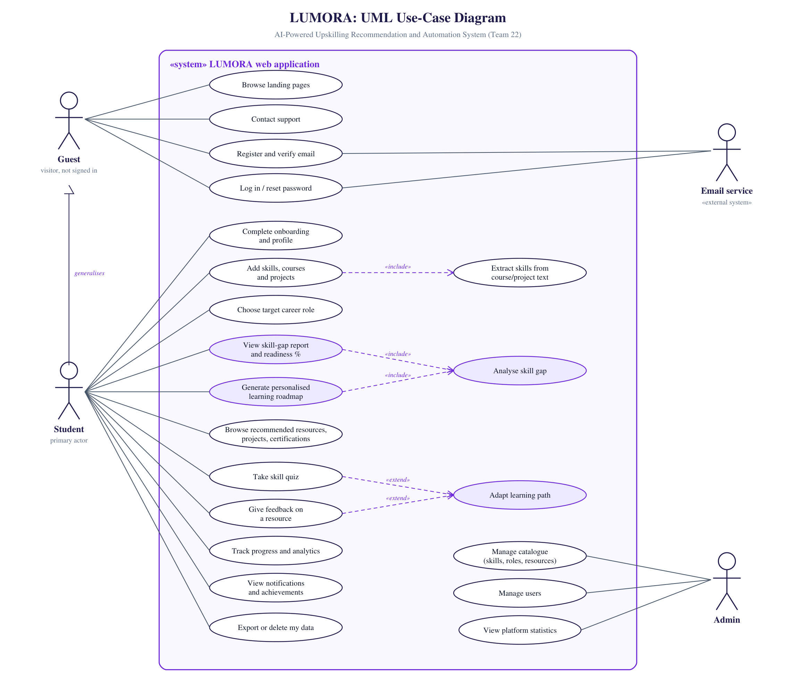

**How to read the diagram.**

- **Actor (stick figure):** someone or something outside the system that uses it.
  - Email service is an external system that sends verification and password-reset mails.
- **Use case (oval):** one goal an actor can achieve with the system, for example "Generate personalised learning roadmap".
- **System boundary (purple box):** everything inside it is part of LUMORA.
- **Plain line:** the actor takes part in that use case.
- **Generalisation (hollow triangle from Student to Guest):**
  - A Student is a special kind of Guest.
  - A Student can do everything a Guest can, such as browse pages and contact support.
- **«include» (dashed arrow):** the base use case always runs the included one.
  - Viewing the gap report and generating a roadmap both always run "Analyse skill gap".
- **«extend» (dashed arrow):** the extending use case adds optional behaviour to the base one under a condition.
  - A quiz score below 50%, or "too hard" feedback, triggers "Adapt learning path".

**Use-case list**

| ID | Use case | Actor | Short description |
| --- | --- | --- | --- |
| UC-01 | Register and verify email | Guest, Email service | Create an account; a one-time link confirms the email |
| UC-02 | Log in / reset password | Guest, Email service | Sign in with email and password; reset by emailed link |
| UC-03 | Complete onboarding and profile | Student | 7-step wizard: programme, year, interests, weekly hours, preferred format |
| UC-04 | Add skills, courses and projects | Student | Rate skills 0 to 5; skills are also found in course and project text (UC-05) |
| UC-05 | Extract skills from text | System (included) | Matches skill names and synonyms, e.g. "Flask app" gives Python and Flask |
| UC-06 | Choose target career role | Student | Pick one of 9 roles; readiness for each is shown |
| UC-07 | View skill-gap report | Student | Required vs current level, severity, priority, readiness % |
| UC-08 | Generate learning roadmap | Student | Ordered modules with resources, a project, hours and due dates |
| UC-09 | Analyse skill gap | System (included) | The scoring step used by UC-07 and UC-08 |
| UC-10 | Browse recommendations | Student | Resources, project ideas and certifications with the reason for each |
| UC-11 | Take skill quiz | Student | Short quiz per skill; the score updates the skill level |
| UC-12 | Give feedback on a resource | Student | Helpful, too easy, too hard, not relevant |
| UC-13 | Adapt learning path | System (extends) | Complete, remediate or replace items and reschedule |
| UC-14 | Track progress and analytics | Student | Progress %, study hours, quiz averages, streaks |
| UC-15 | Notifications and achievements | Student | Every automatic change is listed with its reason; badges |
| UC-16 | Export or delete my data | Student | Download all personal data as JSON, or delete the account |
| UC-17 to UC-20 | Manage catalogue, users, statistics | Admin | Add or edit skills, roles and resources; enable or disable users; platform numbers |

**Full specification of the main use case (UC-08 Generate learning roadmap)**

| Field | Description |
| --- | --- |
| Actor | Student (signed in, email verified) |
| Precondition | Profile has at least one skill and a target role |
| Main flow | 1. Student opens Roadmap and presses Generate. 2. System analyses the skill gap (includes UC-09). 3. System adds missing prerequisites and orders the skills, prerequisites first. 4. For each skill it picks the top resources, one project and the hours needed. 5. System fits the hours into the student's weekly study time and sets due dates. 6. System saves the path, shows it, and logs a notification. |
| Alternative flow | No target role: the system asks the student to choose one (error code NO_TARGET_ROLE). |
| Postcondition | One active learning path; any older one is marked "replaced". |
| Non-functional | Must respond in under 5 seconds (NFR-002); measured: 176 ms at the 95th percentile. |

**Evidence:** `docs/SRS.md`; `docs/reports/img/use-case-diagram.svg` (editable).

## 4. Lab 2: Jira backlog creation and sprint simulation

**What the lab asks.** Plan the work the Agile way:

- Write the backlog as user stories.
- Estimate each story in story points.
- Group the stories into time-boxed sprints.
- Track progress on a board.

**Key terms**

- **User story:** a small piece of value written from a user's point of view, for example "As a student I want a skill-gap report so that I know what to learn first."
- **Epic:** a group of related stories, for example "Accounts and security".
- **Story points:** relative effort on the Fibonacci scale (1, 2, 3, 5, 8). An 8 is roughly four times a 2. Points measure size, not hours.
- **Sprint:** a fixed two-week period with a goal. At the end come a review (demo) and a retrospective (what to improve).
- **Velocity:** points completed per sprint.

**What we did**

- **Backlog:** 44 items, LUM-1 to LUM-44.
  - Each item has an epic, story points, an owner, a priority and a link to the SRS requirement it delivers.
- **Where the backlog lives:**
  - It is kept as GitHub Issues, which works like Jira and is linked to our code.
  - The same backlog is exported as `docs/backlog.csv` (Jira import format) and as the workbook `22_Jira Backlog.xlsx`.
- **Sprints are GitHub milestones,** with labels for points (`sp:5`), priority (`priority:high`) and area (`backend`, `ai-engine`).
- **Each issue is closed by the pull request that implements it.** For example, "Closes #12" in a PR closes issue #12 when the PR is merged.

| Sprint | Dates | Goal | Planned | Completed |
| --- | --- | --- | --- | --- |
| Sprint 1 | 30 Oct – 12 Nov 2026 | Requirements, design, datasets, authentication, Streamlit prototype | 44 pts | 44 pts |
| Sprint 2 | 13 – 26 Nov 2026 | Full product: React UI, all APIs, AI engine, adaptivity, tests, CI | 117 pts | 110 pts |
| Future backlog | – | OAuth, educator dashboard, PDF reports, reminders, learned ranker | 24 pts | – |

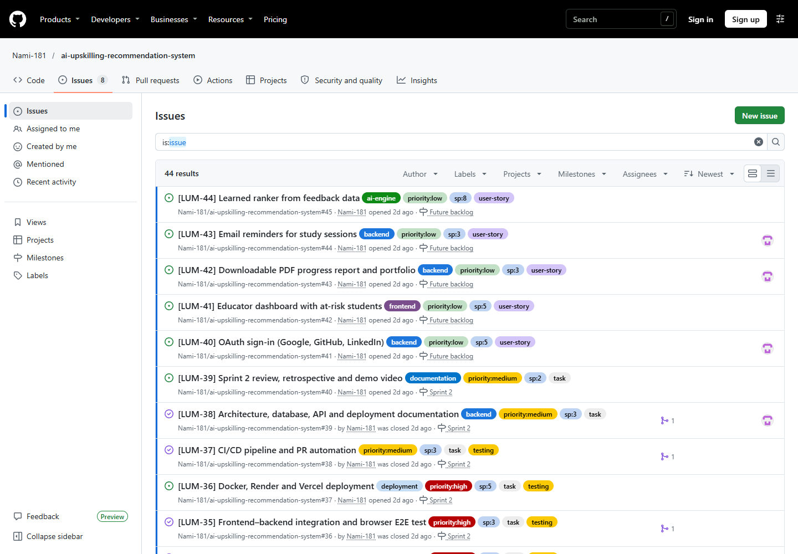

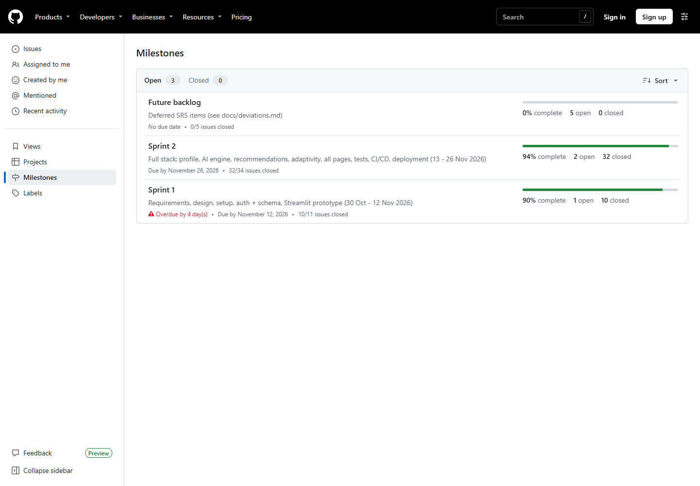

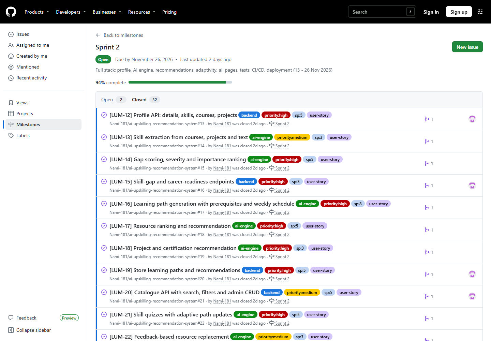

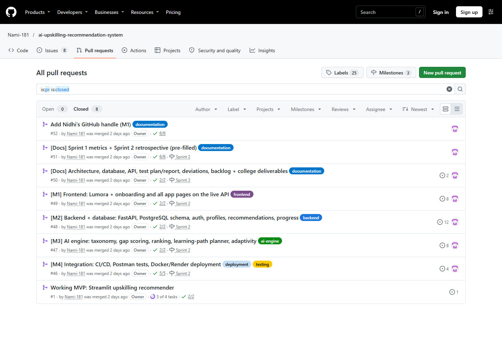

**Evidence:** `docs/backlog.md`, `docs/backlog.csv`, `docs/deliverables/22_Jira Backlog.xlsx`, and `docs/retros/sprint-1.md` and `sprint-2.md` (Project Deliverables 5 and 6).

## 5. Lab 3: Architectural pattern selection and component diagram

**What the lab asks.** Compare architectural patterns, choose one with reasons, and draw a component diagram.

**Patterns considered**

| Pattern | Idea | Fit for LUMORA |
| --- | --- | --- |
| Monolith, no layers | Everything in one program | Fast to start, but hard for 4 people to work on in parallel |
| Microservices | Many small services that talk over the network | Too much setup for a 4-person, 4-week project |
| **Three-tier client–server with a layered backend (chosen)** | Browser UI, then API server, then database. The server is split into routers, services and models | Clear ownership per member; easy to test; can grow later |
| Event-driven | Components react to messages on a queue | Not needed: requests are short and synchronous |

**Why we chose the three-tier, layered style**

- **Matches the team split.**
  - The frontend (M1) talks to the API only through JSON.
  - The backend (M2) owns the API and the database.
  - The AI engine (M3) is a separate library.
  - Tests and CI (M4) sit around all of them.
- **The AI engine is a "pure" library.** It has no web or database code, so it can be unit-tested alone. Later it can become its own microservice without any change.
- **Stateless JWT login.** Any copy of the API server can answer any request, so the system can scale out.

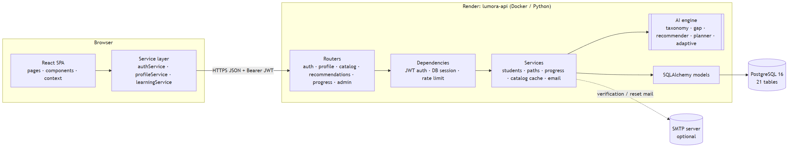

**What each component does**

- **React SPA:** the screens the student sees.
- **Service layer:** the only frontend code that calls the API.
- **Routers:** receive HTTP requests and validate the input.
- **Dependencies:** check the login token, open a database session, and apply rate limits.
- **Services:** the business rules.
- **AI engine:** the calculations.
- **SQLAlchemy models:** map Python classes to the 21 PostgreSQL tables.

**Evidence:** Part 5 of the PDF (SW Architecture document) and `docs/architecture.md`.

## 6. Lab 4: AI-assisted development experience

**What the lab asks.** Use AI coding tools ("vibe coding") in real development, and reflect on how well they worked.

**How we used AI assistance**

- **Tool:** an AI coding assistant (Claude Code) working inside the team's Git repository and terminal.
- **Search before writing.**
  - The assistant first searched for open-source projects close to ours.
  - The backend follows the MIT-licensed `fastapi/full-stack-fastapi-template` (structure, settings, JWT security) instead of starting from scratch.
  - Credits are in `CREDITS.md`.
- **Used for:**
  - backend endpoints,
  - AI-engine formulas and datasets,
  - tests, CI workflows and documentation,
  - Labs 5 to 7 (static analysis, coverage and fuzzing set-up).
- **Every change went through a pull request,** with automated checks: lint, migrations on PostgreSQL, 63 tests with an 85% coverage gate, Postman end-to-end run, and frontend build. A change merges only when everything is green.

**What worked well**

- **Speed:** about 160 story points of work across two sprints, with full documentation.
- **Consistency:** the same error format, naming and test style everywhere.
- **Tests generated together with the code,** which kept coverage above 90%.

**Problems found and how we handled them**

- **The AI's first ranking weights were wrong for one profile** (precision 0.67 on SP2). The evaluation script caught it, and Riya fixed the weights (defect D-04).
- **The AI wrote a hard-coded demo password.** Bandit flagged it in Lab 5, and it was moved to configuration.
- **Generated claims still need checking.** The assistant once described dependency versions as "pinned" when they were only bounded ranges. A review caught it and the text was corrected.
- **Lesson:** AI output is a draft. Tests, CI gates, static analysis and human review are what make it trustworthy.

## 7. Lab 5: Static code analysis

**What the lab asks.** Find defects without running the program, by analysing the source code, then fix or justify each finding.

**Tools used**

| Tool | What it checks | Command |
| --- | --- | --- |
| flake8 | Style (PEP 8), unused imports and variables, undefined names, very long lines | `flake8 app ai_engine tests scripts` |
| bandit | Security weaknesses: hard-coded secrets, unsafe functions, injection risks | `bandit -r app ai_engine` |
| radon | Cyclomatic complexity: the number of independent paths through a function. A is simple; E is very complex | `radon cc app ai_engine -a -s` |
| Vite build | Frontend: syntax and import errors | `npm run build` |

**Results**

| Check | Before | After | Notes |
| --- | --- | --- | --- |
| flake8 | 0 issues | 0 issues | Kept at zero by CI on every pull request |
| bandit | 2 Low (B105) | 0 open | D-05 fixed (demo password moved to settings); D-06 false positive ("bearer" is a token type) marked `# nosec B105` |
| Lines scanned (bandit) | 2,337 | – | 0 Medium, 0 High findings |
| radon average complexity | A (3.3) | A (3.3) | 216 code blocks (functions, methods, classes); 206 rated A or B |

**Complexity hotspots (rated C or worse)**

- **Functions:**
  - `progress.summary` (E, 33)
  - `feedback` (D, 21)
  - `path_out` (D, 21)
  - `update_profile` (C, 17)
  - `post_progress` (C, 16)
  - `evaluate` (C, 17)
  - `apply_quiz` (C, 12)
  - `apply_feedback` (C, 11)
  - `analyze_gap` (C, 11)
  - `order_skills` (C, 11)
- **Why they are complex:** they combine many optional fields into one response.
- **Why this is acceptable:** they are covered by tests (85–100% of their lines run).
- **Plan:** split `progress.summary` into smaller helpers in the next sprint.

**Added to CI:** bandit now runs on every pull request, next to flake8.

**Evidence:** `docs/reports/flake8.txt`, `bandit.txt`, `radon_cc.txt`, `radon_mi.txt`.

## 8. Lab 6: Code and branch coverage analysis

**What the lab asks.** Measure how much of the code the tests actually run, at statement and branch level. Then explain the gaps.

**Definitions**

- **Statement (line) coverage:** the share of code lines executed at least once by the tests.
- **Branch coverage:** the share of decision outcomes taken.
  - Every `if` has two outcomes, true and false. Both must be exercised to count as fully covered.
  - Branch coverage is stricter than line coverage. A line can run while one of its outcomes is never tested.
- **Partial branch:** a decision where only one of its outcomes was tested.

**How we measured:** `pytest --cov=app --cov=ai_engine --cov-branch`. CI fails a pull request if coverage drops below 85%.

| Metric | Covered | Total | Result |
| --- | --- | --- | --- |
| Tests | 63 passed | 63 | 100% pass |
| Statements | 1,776 | 1,909 | **93.0%** |
| Branches | 305 | 400 | **76.3%** |
| Combined (lines + branches) | – | – | **90%** |

**Coverage by module (line + branch)**

| Module | Coverage | Why gaps remain |
| --- | --- | --- |
| AI engine: planner, taxonomy | 100% | Fully covered |
| AI engine: gap, catalog | 96–97% | – |
| AI engine: adaptive, recommender | 88–89% | Rare "no resource left" branches |
| models, schemas | 99% | – |
| services: progress, students | 92–98% | – |
| services: paths | 85% | Rare feedback combinations |
| routes: auth, recommendations, profile, catalog | 85–91% | Some error branches |
| routes: progress | 70% | "Mark all notifications read" path |
| routes: admin | 55% | Enabling and disabling users was tested manually |
| services: email | 52% | Real SMTP sending needs a mail server; the log fallback is tested |

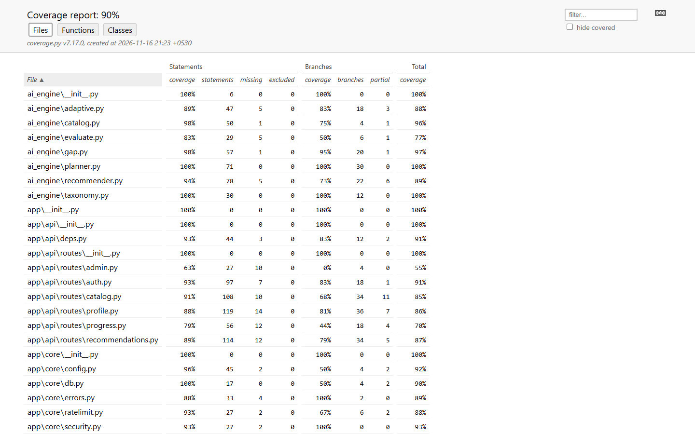

**Evidence:**

- `docs/reports/coverage-html/index.html`: open it in a browser and click a file to see uncovered lines in red and partial branches in yellow.
- `docs/reports/coverage.xml` and `junit.xml`.

## 9. Lab 7: Fuzzing for input validation bugs

**What the lab asks.** Fuzzing feeds a program large amounts of random, malformed or hostile input to find crashes and validation bugs that normal tests miss.

**Approach: property-based fuzzing with Hypothesis.**

- We do not write individual inputs. Instead we state a **property** that must be true for every input.
- Hypothesis then generates 150 inputs per property, including:
  - empty strings, huge strings and emoji,
  - SQL-injection text, script tags and null bytes,
  - wrong types and deeply nested JSON.
- If a property fails, Hypothesis **shrinks** the input to the smallest example that still fails.

**Properties tested** (`backend/tests/test_fuzz.py`)

| # | Target | Property that must hold for every input |
| --- | --- | --- |
| 1 | `POST /auth/register` | Never a server error (5xx); bad input gives 4xx with the standard error body |
| 2 | `POST /auth/login` | Never 5xx, and random credentials never log in |
| 3 | `PUT /profile` | Never 5xx for any mix of fields, types and skill lists |
| 4 | `POST /profile/projects`, `/profile/courses` | Never 5xx for any title, description or URL |
| 5 | `POST /analyze/skills` | Never 5xx for unknown roles, junk skill entries or bad levels |
| 6 | `POST /quizzes/{skill}/attempts` | Never 5xx for unknown skills or garbage answer maps |
| 7 | `POST /feedback` | Never 5xx, signed in or not |
| 8 | `GET /resources` search | Never 5xx for any query, filter or page value |
| 9 | AI engine gap and path | Readiness stays between 0 and 100; prerequisites always come first; every module has hours > 0 and week ≥ 1 |
| 10 | Skill extraction | Never crashes, and only returns real skill ids |
| 11 | Quiz grading | Score always between 0 and 100 |

**Results**

- **Coverage of the fuzzing:** 11 properties × 150 generated inputs = **1,650 fuzz cases. No server errors, crashes or broken invariants were found.**
- **Why the input validation holds up:**
  - Every request body is checked by pydantic schemas (types, lengths, ranges, email format, URL scheme).
  - A global error handler turns any validation failure into a clean 422 response.
- **One problem found, in the test harness itself (D-07):**
  - The fuzzer generated `Infinity` values, which are not valid JSON.
  - The fix was in the generator only; no product bug was involved.
- **Fuzz tests now run in CI with every pull request,** as part of the 63 tests.

## 10. System validation (end-to-end)

System validation checks the whole running system against the requirements, not single functions.

| Test | How | Result |
| --- | --- | --- |
| Postman / Newman | 37 real HTTP requests in order: register, verify, profile, gap, roadmap, quiz, feedback, progress, admin | 48 / 48 assertions passed |
| Browser journeys | A new student signs up and gets a roadmap; the demo student takes a quiz and the plan adapts | Passed, no console errors on 16 pages |
| Recommendation accuracy | 8 sample students with expected answers (`python -m ai_engine.evaluate`) | Precision@3 1.000, prerequisite order 100%, level fit 0.953 |
| Performance | 95th-percentile response times | Roadmap 176 ms (target < 5 s); dashboard 18 ms (target < 3 s) |

**Precision@3:** of the 3 skill gaps the engine ranks first, the share that a human reviewer also listed. 1.000 means all 3 matched for every sample student.

## 11. Project deliverables checklist

| No. | Project deliverable | Status | Where |
| --- | --- | --- | --- |
| 1 | Project SRS; Jira started | Done | Part 3; GitHub Issues |
| 2 | Project Test Plan; complete Jira backlog | Done | Part 4; `22_Jira Backlog.xlsx` |
| 3 | SW Architecture document | Done | Part 5 |
| 4 | SW Design document (update to the architecture spec) | Done: database, API and AI-engine design are inside the architecture document | Part 5, sections 3 to 5 |
| 5 | Sprint 1 completed; retrospective held | Done (44 / 44 points) | `docs/retros/sprint-1.md` |
| 6 | Sprint 2 completed; retrospective | Product done (110 / 117 points); retrospective meeting and demo video with the team | `docs/retros/sprint-2.md` |
| Final | All test reports available | Done | Part 6 |

## 12. Demo screenshots

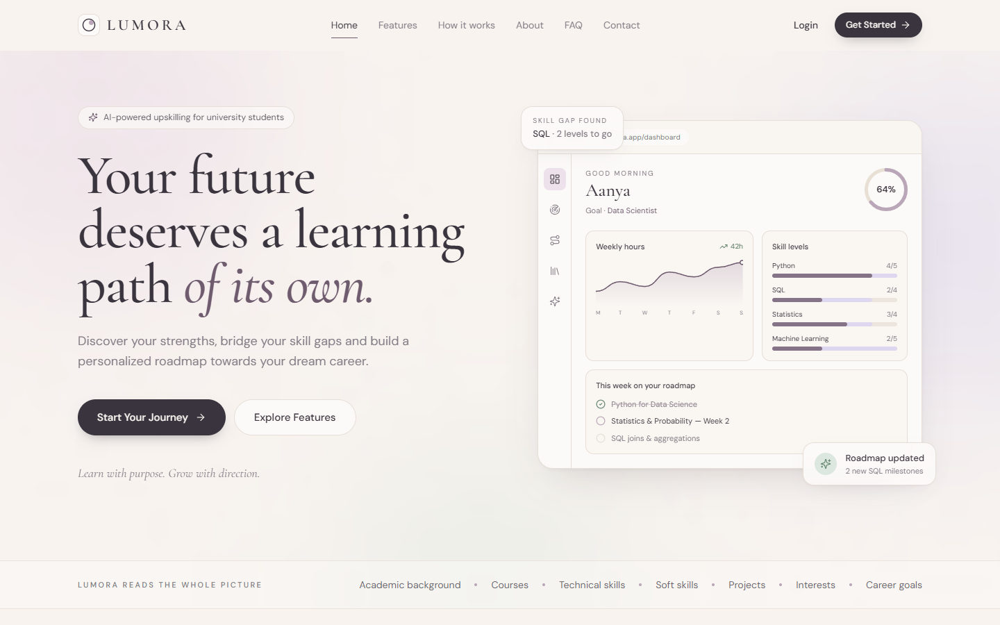

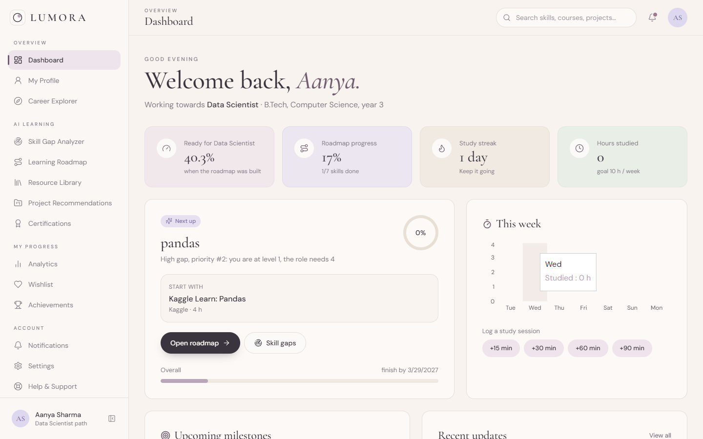

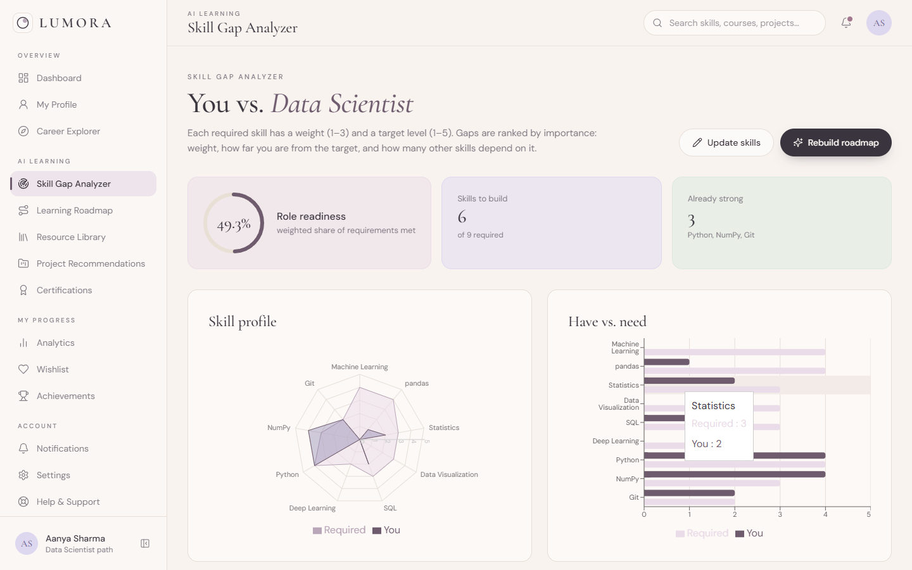

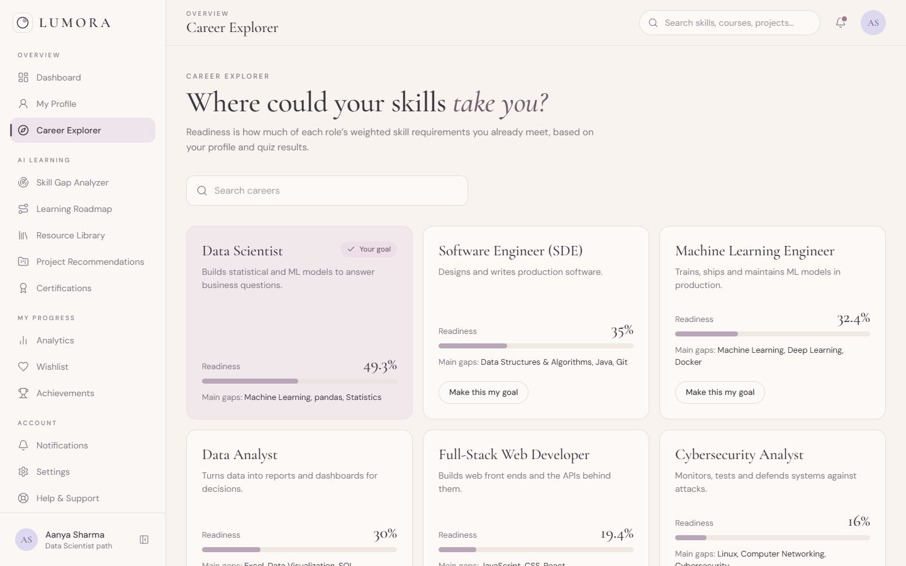

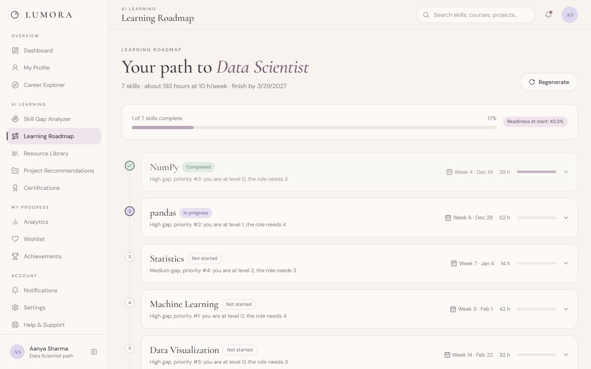

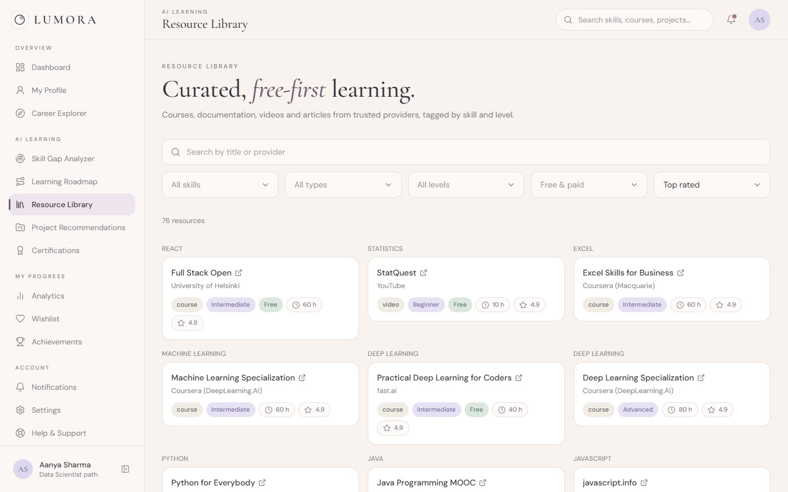

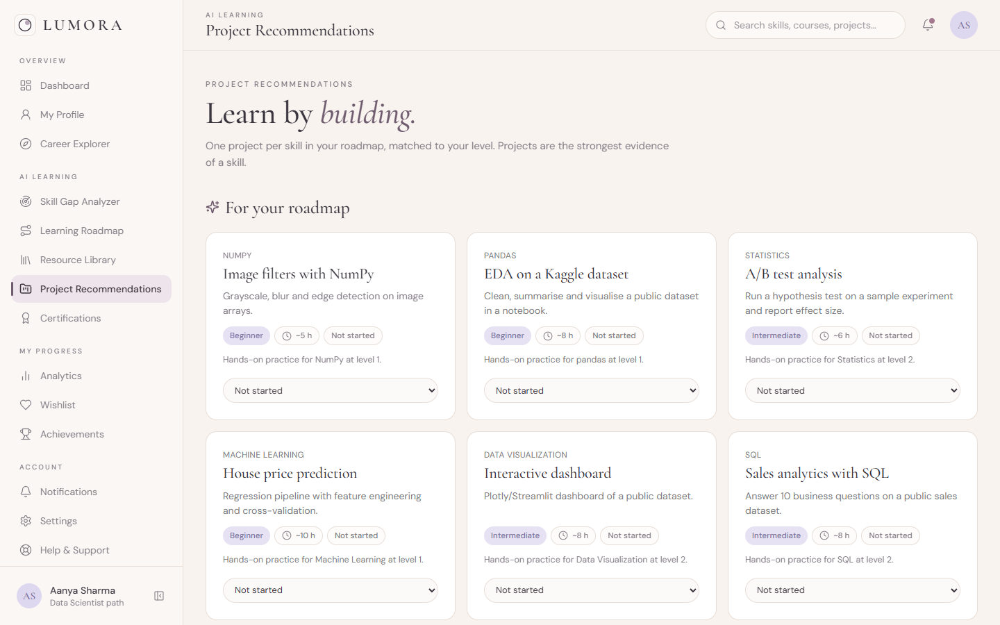

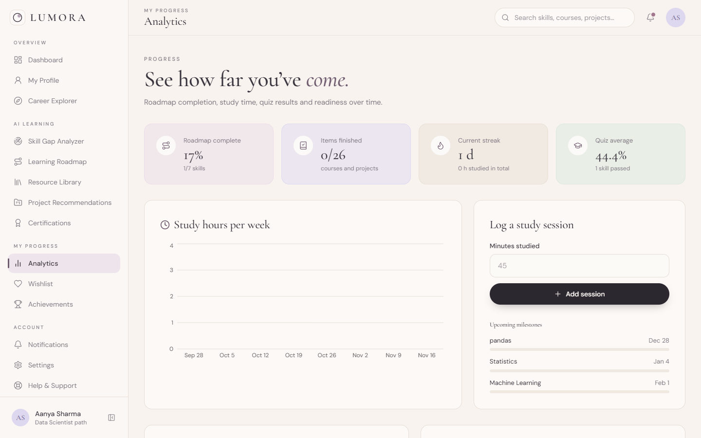

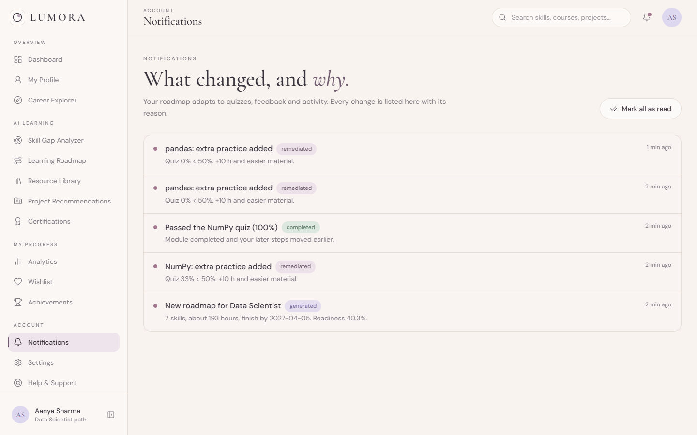

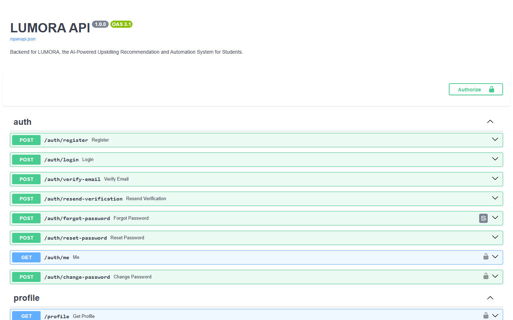

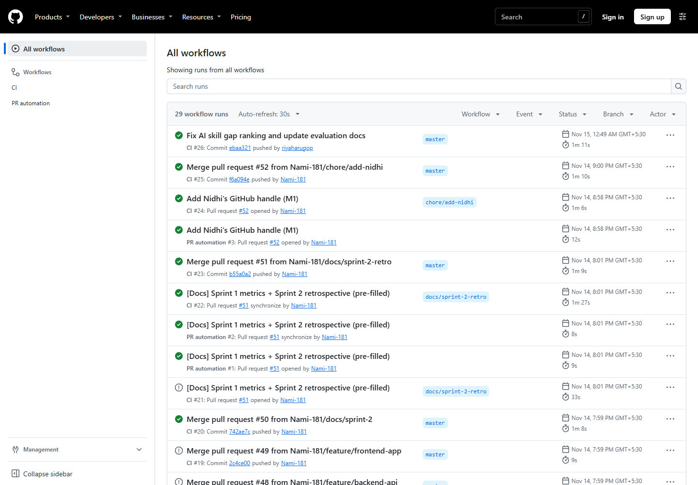

## 13. How to run it yourself

1. Backend: `cd backend`, then `pip install -r requirements-dev.txt`, then `uvicorn app.main:app`. The API runs at http://localhost:8000/docs.
2. Frontend: `cd frontend`, then `npm install`, then `npm run dev`. Open http://localhost:5173.
3. Demo login: `demo@lumora.app` / `Lumora@2026` (student). An admin account is listed in the README.
4. Tests: `cd backend`, then `pytest --cov=app --cov=ai_engine --cov-branch`.
